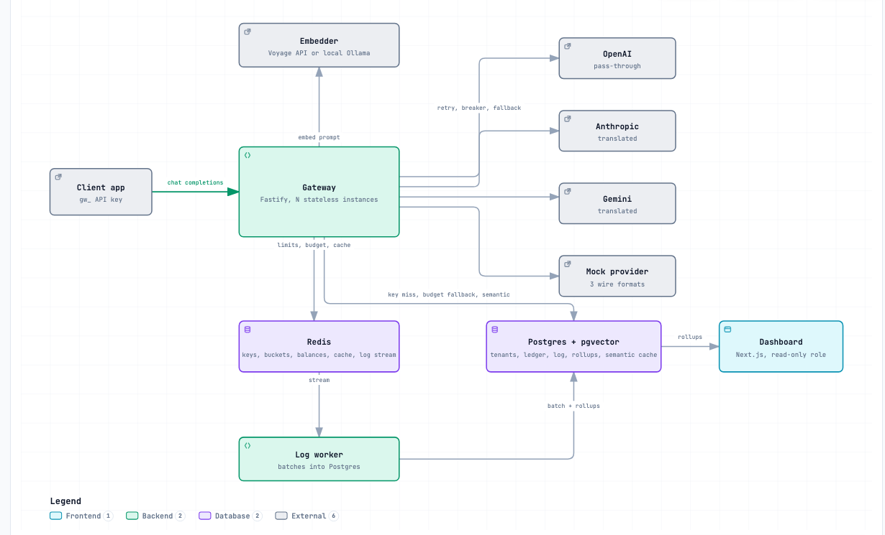

# LLM Gateway

A self-hostable TypeScript proxy that sits between your apps and LLM providers. Apps talk to one
OpenAI-compatible endpoint; the gateway handles routing, per-tenant rate limits and budgets,
provider failover and caching, and logs every request off the request path.

> **Status:** v1 complete; measured on one laptop. Every figure below comes from a committed benchmark run
> you can repeat from this repo, and the load generator shared the machine with what it measured.
> **Demo video:** coming.



[Explorable diagram](docs/architecture/architecture.html) (open it in a browser) and the
[architecture notes](docs/architecture/README.md).

## What it does

- **Unified API:** one OpenAI-compatible `POST /v1/chat/completions`, routed by model name to OpenAI,
  Anthropic or Gemini (or the mock). Anthropic and Gemini formats and streams are translated to OpenAI's without buffering.
  The Anthropic and Gemini adapters were written against the providers' documentation and tested on fixtures; no live
  key was available, so they have not been run against a live provider.
- **Auth and tenancy:** API keys per tenant, HMAC-hashed at rest, cached in Redis, revocable at once.
  Limits and budgets are set per key and per tenant from a CLI.
- **Rate limiting:** token buckets per key (requests and tokens per minute) in one atomic Redis Lua script, so the
  count is shared by every gateway instance. If Redis is slow or down, the limiter fails open.
- **Budgets:** a hard monthly spend cap per tenant, in integer micro-USD. The worst-case cost is reserved in Redis
  before the call and replaced by the actual cost after; Postgres records every charge and decides while Redis is down.
  A request over the cap is refused with 402.
- **Resilience:** per-phase timeouts, retries with jittered backoff, a circuit breaker per provider shared through Redis,
  and an ordered fallback chain of models.
- **Caching:** an exact-match response cache (single upstream call per burst of identical requests, streamed replay,
  zero-cost hits). A semantic cache exists but is **off by default**: with the local embedder no threshold keeps its
  wrong-answer rate under 1% (see the table), so nobody should turn it on yet.
- **Observability:** every request becomes one entry in a Redis stream; a log worker batch-inserts them into Postgres
  and maintains the dashboard's rollups in the same transaction.
- **Dashboard:** a read-only Next.js page: p50/p95 latency, spend by tenant, cache hit rate and error rate over time, from rollups.
- **Mock provider:** an OpenAI-compatible stand-in with configurable latency, errors and outages, so benchmarks measure
  the gateway and not a provider.

## Measured

Apple M5, 10 cores, 24 GB, Node v26.4.0, k6 v2.3.0, nginx in front, Postgres 17 and Redis 7.4 in Docker under Colima.
k6, nginx, up to 3 gateways, the log worker and the mock all ran on that one machine, so every ceiling is this laptop's.
Cells are medians of 3 repeats (10 for correctness). Method, conditions, ranges and the runs that were thrown out and why:
[BENCHMARKS.md](BENCHMARKS.md).

| Area | What is measured | Result |
|---|---|---|
| Overhead | Gateway-added latency, p50 / p95 | 1.4 ms / 2.1 ms non-streamed (instant mock); inside the noise against a 200 ms provider |
| Throughput | Ceiling and breaking point, every feature on, through nginx | ceiling 2000 req/s; breaking point 4000 req/s with one instance, 6000 (5000 to 6000) with three; after one index fix 4000 and 5000 (4000 to 5000) |
| Steady load | 60 s at 60% of the ceiling (1200 req/s) | 0 failures in 216003 requests; p95 8.6 ms (1 instance) and 9.1 ms (3) |
| Correctness | Over-limit and over-cap requests, 3 instances, 10 runs each | 0 over the rate limit, 0 over the budget cap, also with Redis restarted mid-run |
| Resilience | Success while the primary provider is down | 100.00% non-streamed and 99.33% streamed with a fallback chain; fails fast without one |
| Caching | Exact-match hit rate on a Zipf prompt draw | 96.70%, hits in 1.1 ms p50 against 403.5 ms for a miss; 50 identical requests make 1 upstream call |
| Semantic cache | Wrong answers served, held-out QQP and PAWS pairs | no threshold stays under 1% wrong with the local embedder (best 55.89%), so it stays off by default |
| Dashboard | Overview query over 30 days at 5,000,000 log rows | 23.5 ms on the rollups against 2708 ms from the raw log, same answers |

What limits it: at 4000 req/s one gateway process is CPU-bound, and about two thirds of that CPU is rebuilding budget
balances from Postgres after Redis calls time out. The write-up is in [BENCHMARKS.md](BENCHMARKS.md#ceiling-and-breaking-point-1-vs-3-instances).

## Quick start

Needs Node 24+ (26 recommended), npm and Docker. No provider key: requests go to the bundled mock.

```
npm ci
cp .env.example .env.local
docker compose up -d --wait redis postgres   # Redis on :6379, Postgres + pgvector on :5436
npm run db:migrate
npm run keys -- create-tenant demo
npm run keys -- create-key demo              # prints a gw_... key once; copy it
```

Then three terminals:

```
npm run dev:mock        # mock provider on :9000
npm run dev:gateway     # gateway on :8080
npm run worker          # log worker: writes request logs and settled spend to Postgres
```

```
curl -N localhost:8080/v1/chat/completions \
  -H 'content-type: application/json' -H 'authorization: Bearer gw_...' \
  -d '{"model":"mock-openai-1","stream":true,"messages":[{"role":"user","content":"hi"}]}'
```

You get a streamed completion ending in `data: [DONE]`. Add `-i` to see the `x-gateway-*` and `x-budget-remaining-usd`
headers. Run the worker whenever a gateway runs: spend reaches Postgres only through it. `npm run check` runs typecheck and tests;
`npm run dashboard` starts the dashboard (set `DASHBOARD_TOKEN`, `DASHBOARD_SESSION_SECRET` and `DASHBOARD_DATABASE_URL` first, see
[docs/dashboard](docs/dashboard/README.md)). To try a real provider, put its key in `.env.local` and use one of its model names.

## Reproduce the benchmarks

Needs [k6](https://k6.io) and nginx (`brew install k6 nginx`), Postgres and Redis up and migrated, the laptop on
mains power and otherwise idle (`bench/quiet.sh` waits for a load average under 2.0 before every scenario).

```
bash bench/run-all.sh --smoke   # every scenario with tiny durations; proves the wiring, its numbers mean nothing
bash bench/run-all.sh           # the full suite into bench/results/final/ (several hours)
```

`--only cluster,correctness` runs a subset. The semantic scenarios also need Ollama (`docker compose up -d ollama ollama-pull`).
The raw k6 output and summaries behind every number are committed under `bench/results/final*/`.

## Design decisions

- **Reserve, then settle** budgets: hold the worst case atomically before the call so two gateways can never spend the
  same cents; Postgres is the record and takes over when Redis is down. [docs/budgets](docs/budgets/README.md)
- **One Lua script per rate-limit check**, so the bucket is exact across instances; it fails open because a limiter outage should not take the API down. [docs/rate-limiter](docs/rate-limiter/README.md)
- **Circuit breaker state in Redis** and fallback chains priced at the dearest model, so a failover can never push a tenant past its cap. [docs/resilience](docs/resilience/README.md)
- **Logs leave the request path**: one `XADD` after the response; a worker writes batches and rollups in one transaction. [docs/request-log](docs/request-log/README.md)
- **The dashboard reads rollups**, with percentiles from fixed-bucket histograms, never the raw log. [docs/dashboard](docs/dashboard/README.md)
- **Single-flight exact cache**: a burst of identical requests makes one upstream call. [docs/cache](docs/cache/README.md)
- **The semantic cache is opt-in and guarded** (numbers, names, quotes, negation must agree), and still off by default for the reason in the table. [docs/semantic-cache](docs/semantic-cache/README.md)
- **A mock provider and a native rig**, so a benchmark measures the gateway and not Docker's network or a vendor. [docs/benchmarks](docs/benchmarks/README.md)

All parts, each with a diagram: [docs/](docs/README.md).

## Known limits

Stated here because they are part of the proof, not hidden from it.

- **One laptop.** Single machine, load generator included, behind Colima's port forward. The ceilings are this machine's; three
  instances compete for the same 10 cores.
- **Budget rebuilds are not shared.** When Redis calls time out under load, each in-flight request rebuilds a tenant's balance from
  Postgres on its own. This sets the breaking point; single-flight rebuilds are future work.
- **Partial Redis outages can overshoot a cap briefly.** Instances that did not see an outage keep using the old balance for up to 250 ms.
  Earlier single-instance runs saw 2 of 13 outage runs go over by 1 to 2%; the final suite saw 0 of 10 over the cap with Redis restarted
  mid-run on 3 instances. The mechanism remains. [docs/budgets](docs/budgets/README.md#known-limits-documented-not-closed-here)
- **A gateway killed between its two hold writes** can leave a hold Redis never counted; the sweeper charges its estimate, so spend can pass a cap by one
  estimate per request killed in that window. The chaos runs kill a provider, not a gateway.
- **No connection timeout on the main Postgres pool.** Exhausted connections would show as `503 budget_unavailable`; none appeared in any final run.
- **Migrations build two indexes without `CONCURRENTLY`**, and the rollup fold's lock was not measured across an hour boundary.
  Fine at this size; see [docs/dashboard](docs/dashboard/README.md#known-limits).
- **Benchmark harness gaps.** `run-semantic.sh` and `run-budget.sh` start gateways with budgets on and no log worker, and the worker launch is copied
  between scripts. The published numbers come from the committed scripts, so these were left as they are.
- **The semantic cache is off by default**: no threshold kept wrong answers under 1% with the local embedder (best 55.89% wrong at 0.88). The Voyage
  API embedder and cross-model matching were not evaluated.
- **Not measured:** translation overhead per provider format, and the overhead of the rate limiter and the budget hold written separately.

## Roadmap (out of scope for v1)

- Prompt management UI
- Fine-tuning
- Billing integration
- Plugin system
- Multi-region deployment

## License

[MIT](LICENSE)
